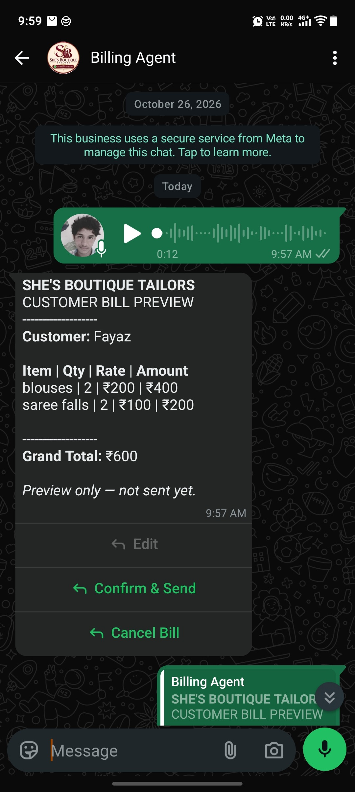
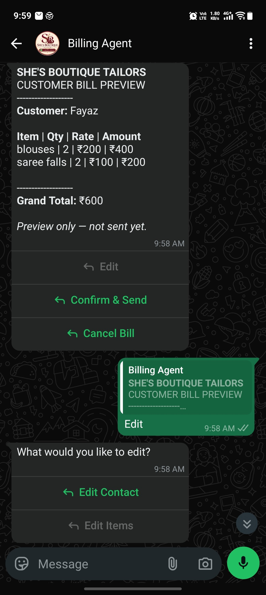
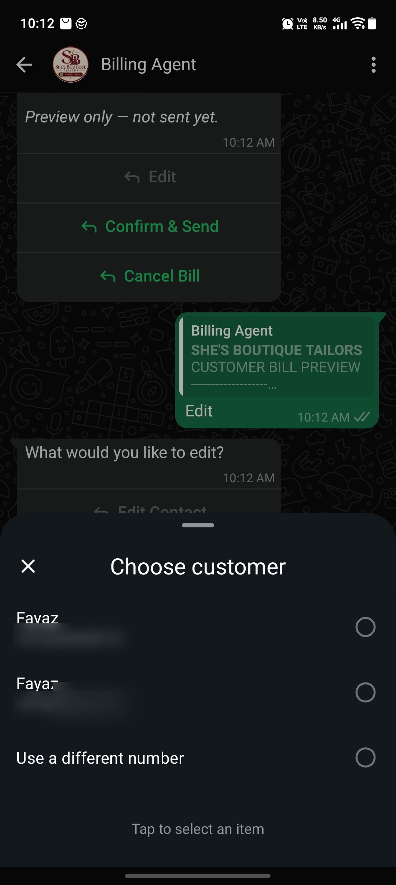
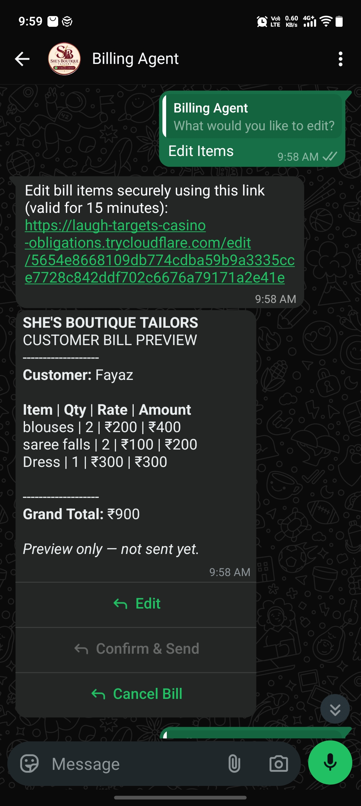
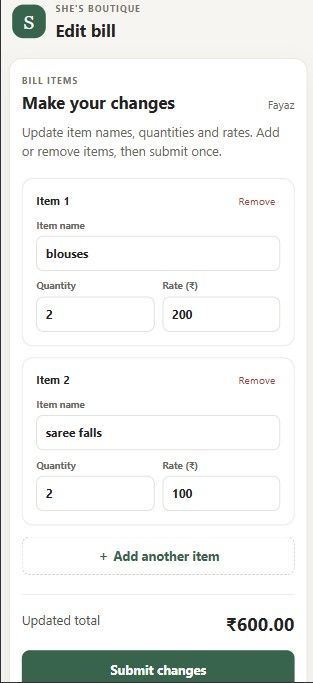
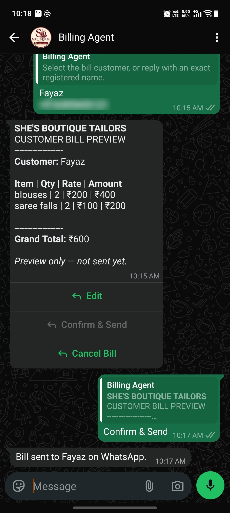
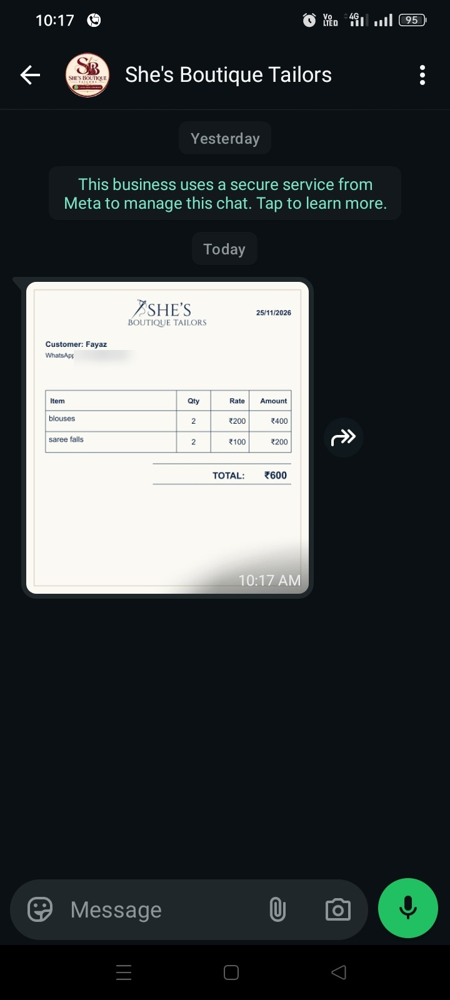
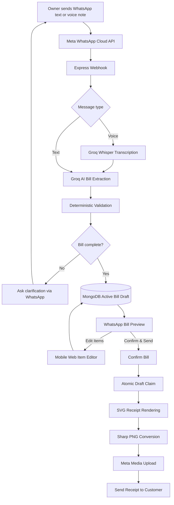

# WhatsApp Billing Assistant

A voice-first, AI-powered billing assistant for tailoring businesses. It transforms WhatsApp voice notes and text messages into structured, validated bill drafts, helps resolve missing information, and delivers branded digital receipts to customers after confirmation.

## Overview

The WhatsApp Billing Assistant simplifies the billing process for tailoring businesses by allowing the owner to create and manage customer bills directly through WhatsApp.

Instead of manually entering every item and calculating totals, the owner can send voice notes or text messages describing the bill. The application transcribes voice messages, extracts structured billing information, validates the data, and maintains the draft across follow-up messages.

Once the bill is complete, the owner can review, edit, confirm, and send a branded PNG receipt to the selected customer.

## Features

- **Voice-based billing:** Accepts WhatsApp voice notes and text messages as billing instructions.
- **AI-powered extraction:** Uses Groq Whisper and a Groq language model to extract item names, quantities, prices, discounts, and advance payments.
- **Context-aware conversations:** Preserves active bill drafts across follow-up messages, allowing the owner to provide corrections and additional details.
- **Deterministic validation:** Validates extracted billing information and requests clarification when required details are missing or ambiguous.
- **Customer management:** Supports customer selection and customer contact updates through WhatsApp.
- **Bill editing:** Provides a mobile-friendly web form for editing bill items through a short-lived, single-use link.
- **WhatsApp bill preview:** Presents the prepared bill with Edit, Confirm & Send, and Cancel Bill actions.
- **Branded receipt generation:** Renders portrait-style PNG receipts locally using SVG and Sharp.
- **Automated delivery:** Uploads the generated receipt to Meta and sends it to the selected customer.
- **Persistent drafts:** Stores customer records and active bill drafts in MongoDB.
- **Duplicate-send protection:** Uses atomic bill-draft claiming and in-process message deduplication to reduce duplicate processing and sends.

## Demo and Screenshots

The screenshots below follow the billing conversation from the initial voice
note through editing and receipt delivery. Customer phone numbers and the
temporary bill-edit link have been redacted.

<table>
  <tr>
    <td align="center"><strong>1. Voice note and bill preview</strong><br></td>
    <td align="center"><strong>2. Edit options</strong><br></td>
    <td align="center"><strong>3. Customer selection</strong><br></td>
    <td align="center"><strong>4. Item editor link</strong><br></td>
  </tr>
  <tr>
    <td align="center"><strong>5. Edit bill items</strong><br></td>
    <td align="center"><strong>6. Confirm and send</strong><br></td>
    <td align="center"><strong>7. Delivered receipt</strong><br></td>
    <td></td>
  </tr>
</table>

## Technology Stack

| Layer                 | Technology                              |
| --------------------- | --------------------------------------- |
| Runtime               | Node.js (ES Modules)                    |
| Backend               | Express.js                              |
| Messaging             | Meta WhatsApp Cloud API                 |
| Speech-to-text        | Groq Whisper (`whisper-large-v3`)     |
| AI bill extraction    | Groq Chat API (`openai/gpt-oss-120b`) |
| Structured extraction | JSON response mode                      |
| Database              | MongoDB with Mongoose                   |
| Receipt rendering     | SVG and Sharp                           |
| Web item editor       | HTML, CSS, and JavaScript               |

## Architecture

The application follows a webhook-driven architecture in which WhatsApp handles communication, Groq handles transcription and structured extraction, MongoDB maintains customer and draft data, and the backend manages validation, editing, and receipt delivery.



### Processing workflow

1. The owner sends a voice note or text message to the configured WhatsApp Business number.
2. Meta forwards the message to the Express webhook, which verifies the webhook signature and acknowledges the request before asynchronous message processing.
3. Voice messages are downloaded and translated into English using Groq Whisper.
4. The Groq chat model extracts structured billing information from the message.
5. Deterministic validation checks item names, quantities, prices, discounts, advance payments, and other required values.
6. Incomplete or ambiguous information is sent back to the owner as clarification questions.
7. The validated bill is maintained as an active draft in MongoDB, preserving context across follow-up messages.
8. The owner reviews the bill through WhatsApp and can:
   - Edit the customer details.
   - Open a mobile-friendly web form to modify bill items.
   - Confirm and send the bill.
   - Cancel the draft.
9. On confirmation, the application atomically claims the draft, calculates the final amount, generates the PNG receipt, uploads it to Meta, sends it to the selected customer, and marks the draft as sent.

**Processing note:** Messages are serialized per sender within a single server process. The application does not currently use a separate durable job queue.

## Receipt Generation

The application renders branded portrait PNG receipts locally from SVG using Sharp, without external image-generation or browser-rendering services. Receipts use the `Asia/Kolkata` date, automatically wrap item names, resize for item count, and display a right-aligned total. The logo is read from `src/assets/boutique-logo.png`.

Generated images remain in memory and are not stored permanently. Images over 5,000,000 bytes are rejected rather than sent.

**Receipt limitations:** Discounts and advance payments are applied to the final calculation but are not displayed as separate rows on the receipt. Therefore, the final total may differ from the sum of the visible item amounts.

## Project Structure

```text
Whatsapp-Billing-Agent/
│
├── data/                         # Local customer seed data (ignored)
├── downloads/                    # Downloaded WhatsApp media (ignored)
├── public/                       # Mobile bill editor assets
│
├── scripts/                      # Customer seeding and webhook tests
│
├── src/
│   ├── assets/
│   │   └── boutique-logo.png
│   │
│   ├── config/                   # Application configuration
│   ├── controllers/              # Webhook and web editor controllers
│   ├── models/                   # Mongoose schemas
│   ├── routes/                   # Express route definitions
│   │
│   ├── services/
│   │   ├── transcription.service.js
│   │   ├── parser.service.js
│   │   ├── bill-validation.service.js
│   │   ├── billing.service.js
│   │   ├── bill-draft.service.js
│   │   ├── bill-edit-web.service.js
│   │   ├── bill-image.service.js
│   │   ├── whatsapp.service.js
│   │   └── media.service.js
│   │
│   ├── app.js
│   └── server.js
│
├── tests/                        # Application test suites
├── .env.example
├── package.json
└── README.md
```

## Getting Started

### Prerequisites

- Node.js 20.9+, npm, and MongoDB
- Meta WhatsApp Business configuration and a Groq API key
- A publicly accessible HTTPS endpoint for webhooks and bill editing

### Installation

```bash
git clone https://github.com/ShaikFayaz042/Whatsapp-Billing-Agent.git
cd Whatsapp-Billing-Agent
npm ci
```

### Environment Configuration

Copy `.env.example` to `.env`:

```bash
cp .env.example .env
```

Windows PowerShell: `Copy-Item .env.example .env`

Configure the required values:

| Variable | Purpose |
| --- | --- |
| `MONGODB_URI` | MongoDB connection string |
| `OWNER_WA_ID` | Numeric WhatsApp ID of the business owner |
| `META_VERIFY_TOKEN` | Meta webhook verification token |
| `META_APP_SECRET` | Meta webhook signature secret |
| `WHATSAPP_ACCESS_TOKEN` | WhatsApp messaging and media access token |
| `PHONE_NUMBER_ID` | WhatsApp Business phone-number ID |
| `GROQ_API_KEY` | Groq transcription and bill-extraction key |
| `BILL_EDIT_BASE_URL` | Public HTTPS origin for bill-edit links |
| `PORT`, `NODE_ENV`, `GRAPH_API_VERSION`, `SEED_CUSTOMERS` | Optional runtime settings |

Optional defaults include port `3000`, Graph API version `v25.0`, and customer seeding disabled.

### Meta Webhook Configuration

```text
https://<your-public-host>/webhook
```

Configure this callback in Meta, subscribe to the `messages` field, and use `META_VERIFY_TOKEN` for verification. Ensure the server is reachable over public HTTPS and that `META_APP_SECRET`, `WHATSAPP_ACCESS_TOKEN`, `PHONE_NUMBER_ID`, and `BILL_EDIT_BASE_URL` are valid. For local development, expose the server through an HTTPS tunnel.

### Start the Application

```bash
node src/server.js
```

The server requires a running MongoDB instance and a numeric `OWNER_WA_ID`; only that sender is accepted for billing instructions. It runs directly as Node.js ES modules with no build step.

## Optional Customer Seeding

Customer records can be seeded into MongoDB using the local `data/customers.json` file.

1. Add your customer records to `data/customers.json`.
2. Set the following variable in `.env`:

```env
SEED_CUSTOMERS=true
```

3. Run the seed command:

```bash
npm run seed:customers
```

The seed operation upserts customers using their normalized E.164 phone numbers.

After seeding, disable the option:

```env
SEED_CUSTOMERS=false
```

Customer names are not unique. Ambiguous customer-name matches require a selection or phone number.

Do not commit real customer information or sensitive environment variables.

## Application Routes

| Method   | Endpoint              | Purpose                                              |
| -------- | --------------------- | ---------------------------------------------------- |
| `GET`  | `/webhook`          | Meta webhook verification challenge.                 |
| `POST` | `/webhook`          | Receives signed WhatsApp messages and status events. |
| `GET`  | `/edit/:token`      | Loads the bill item editor.                          |
| `GET`  | `/edit/:token/data` | Retrieves bill information for the editor.           |
| `POST` | `/edit/:token`      | Validates and saves bill item changes.               |
| `GET`  | `/edit-assets/*`    | Serves editor CSS and JavaScript assets.             |

The application currently does not expose a mounted health or readiness endpoint.

## Testing

The repository includes focused test suites for the major billing and conversation workflows.

Run the available test commands:

```bash
npm run test:billing
npm run test:validation
npm run test:translation
npm run test:extraction
npm run test:customers
npm run test:conversation
```

Run receipt rendering and WhatsApp payload tests:

```bash
node --test tests/bill-image.service.test.js tests/whatsapp.service.test.js
```

### Webhook Smoke Test

Start the application with a configured `.env` file, then run:

```bash
npm run test:webhook
```

The webhook smoke test requires:

- `META_APP_SECRET` configured in the environment.
- A running application server.
- `WEBHOOK_URL` pointing to the webhook endpoint, if using a non-default address.

The default webhook URL is:

```text
http://localhost:3000/webhook
```

**Testing note:** There is currently no aggregate `npm test` script. Run the individual test suites above.

## Security and Operational Considerations

- Webhook signatures are verified with HMAC SHA-256.
- Only the configured owner WhatsApp ID can send billing instructions.
- Edit links use 256-bit random tokens; only token hashes are stored, and links expire after 15 minutes or after use.
- Anyone with a valid edit link can access the associated editor.
- Keep `.env` secrets out of source control and secure MongoDB data with access controls, backups, and encryption.
- Downloaded audio is retained locally; define cleanup and logging policies that avoid exposing customer data.
- Outbound free-form WhatsApp messages must follow Meta's customer-service messaging window.

## Known Limitations and Trade-offs

- Runs in one server process with no durable job queue.
- Deduplication is in-memory and not shared across instances.
- A crash after webhook acknowledgement may lose message processing work.
- Delivery failures or process crashes may leave drafts in `SENDING_BILL`.
- No separate bill-history or idempotency collection is maintained.
- Generated receipts are PNGs: text is non-selectable and oversized images are rejected.
- Discounts and advances are applied but not shown separately.
- Downloaded audio requires manual cleanup.
- There is no centralized logging, health endpoint, metrics, or alerting.
- Rate limiting, request timeouts, distributed retries, and provider-failure recovery are not implemented.


## Future Enhancements

- **AI-Powered Conversational Agent:** Evolve the assistant into a fully capable AI agent that understands natural conversations, manages billing tasks, and handles follow-up requests intelligently.
- **Direct Customer Ordering:** Enable customers to interact with the AI agent directly through WhatsApp, browse services, place orders, and track order status.
- **Automated Customer Support:** Extend the agent to handle customer queries, order updates, billing inquiries, and routine support requests.
- **End-to-End Business Automation:** Expand the assistant beyond billing into an AI-powered business assistant that coordinates customer interactions, orders, and billing workflows.

## License

This project is licensed under the [ISC License](https://opensource.org/license/isc-license-txt/), as declared in [`package.json`](package.json).
